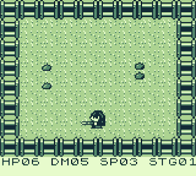
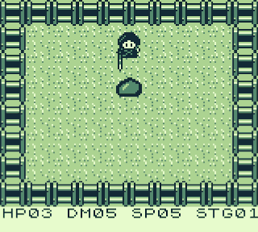
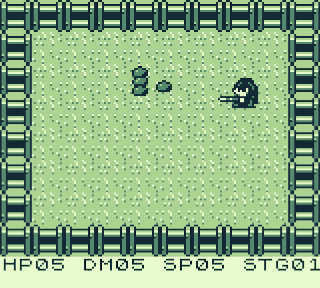
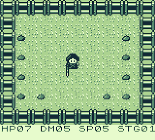
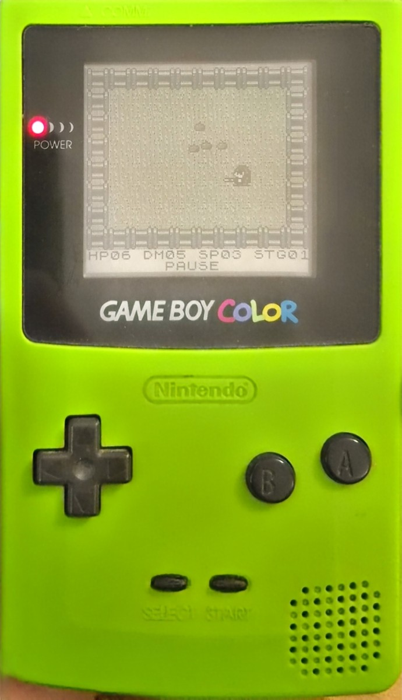
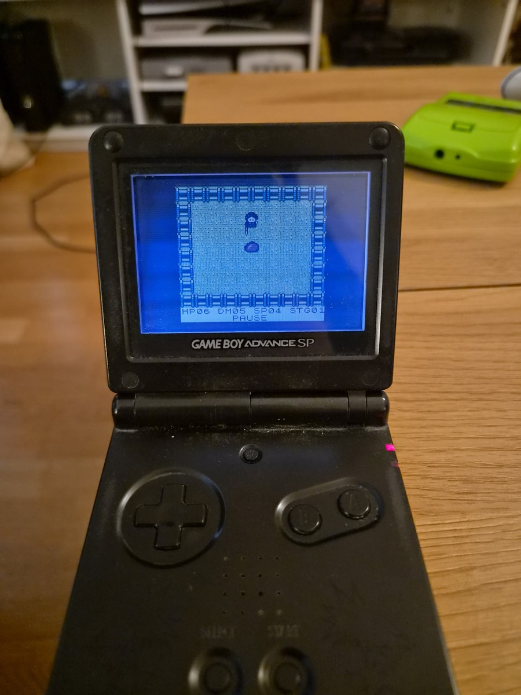

# Slime Killer GB

A room-based action game for the Game Boy, written in C with GBDK. Fight slimes with a directional sword attack, clear each room, and collect upgrades before moving into the next encounter.

<p align="center">
  
</p>

## Gameplay

### Sword combat

Move around the arena, face your target, and time each sword strike as slimes close in.



### Larger threats

Large slimes share the arena with smaller enemies, adding pressure to close-range combat.



### Clear, upgrade, continue

Clearing a room reveals a reward. The game supports health, damage, and speed upgrades; this clip shows a health upgrade and the transition into the next encounter.



### Swarm encounters

Denser encounters fill the arena with slimes, making positioning and attack timing increasingly important.



*Clips are silent excerpts from the recorded playthrough. The green presentation is retained from the recording.*

## On hardware

Slime Killer on Game Boy Color and Game Boy Advance SP.

| Game Boy Color | Game Boy Advance SP |
| :---: | :---: |
|  |  |

## Controls

| Input | Action |
| --- | --- |
| D-pad | Move and face a direction |
| A | Sword attack; advance after claiming a room reward |
| Start | Start the game; pause or resume during combat; confirm a room reward and advance; restart after defeat |

## Under the hood

- **C and GBDK:** gameplay logic is written in C and compiled with GBDK's `lcc` toolchain.
- **Graphics:** tile data and maps define the arena; sprites represent the player, sword, and enemies. The Game Boy window layer displays health, damage, speed, and stage information.
- **Memory:** fixed-size arrays hold up to ten enemy records and per-attack hit flags. Graphics are loaded into video RAM through GBDK, and sprite IDs control the on-screen objects through its sprite APIs.
- **Shade handling:** `BGP_REG` maps background shades, while `OBP0_REG` and `OBP1_REG` map player/sword and enemy sprite shades. These are the original Game Boy's monochrome palette registers. The project does not define custom Game Boy Color RGB palettes.
- **Combat and progression:** directional attacks, hit detection, knockback, temporary invulnerability, six room definitions, slime and boss behavior, and health, damage, or speed rewards. Completing a full room cycle advances the stage and increases enemy health.

The main game loop is in [main.c](main.c). [GameCharacter.c](GameCharacter.c) defines entity data structures, and the other C/H graphics files contain tile, sprite, and map data. The tracked [main.asm](main.asm) is **SDCC-generated assembly output**, rather than a separately handwritten implementation.

## Build

The included build script targets **Windows** and expects [GBDK-2020](https://github.com/gbdk-2020/gbdk-2020) at `C:\gbdk`. Clone or download this repository, open a terminal in its root folder, and run:

```powershell
.\make.bat
```

If GBDK is installed elsewhere, update the two compiler paths in [make.bat](make.bat). The script compiles `main.c` into `main.o` and links it into `main.gb`.

The existing source includes `windowmap.c` while the tracked file is named `WindowMap.c`; the supplied workflow relies on Windows' usual case-insensitive filesystem. A build on a case-sensitive filesystem needs that filename mismatch addressed.

## Run

Build the project first, then open the generated `main.gb` in a Game Boy emulator and map the controls above to your keyboard or controller. ROM and intermediate build files are excluded by the repository's `.gitignore`.

## Verification

The publication build was checked on Windows with GBDK 4.5.0 and SDCC 4.5.1. The existing build script produced a 32 KiB ROM, with two SDCC optimizer warnings in `boss_ai` (warning 110). No gameplay code was changed for this portfolio update.

A headless smoke test with PyBoy 2.8.1 passed in DMG and CGB modes: title screen, start, movement, pause/resume, and extended attack/movement inputs. This was not a complete playthrough or an audio test.

The gameplay GIFs and hardware photographs document the supplied playthrough and devices. They are not asserted to show the exact binary produced by this build.
